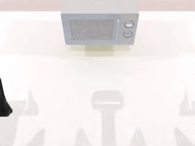
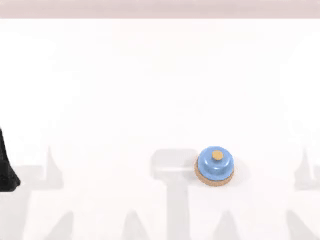
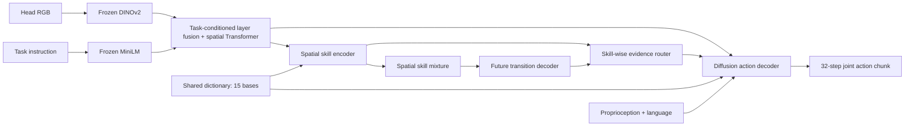

# TRACE

[中文说明](README.zh-CN.md)

**Task-conditioned visual abstraction and predictive skill dictionary learning for robot manipulation.**

This repository is a compact implementation of our RoboTwin V4 experiment. TRACE uses language to fuse multi-layer visual features, represents each spatial patch with a shared skill dictionary, and predicts future feature changes. A second-stage diffusion policy uses the frozen representation and a learned skill router to generate actions.

## Selected successful rollouts

| Open microwave | Click bell | Place container on plate |
|:---:|:---:|:---:|
|  |  |  |
| [MP4](assets/open_microwave.mp4) | [MP4](assets/click_bell.mp4) | [MP4](assets/place_container_plate.mp4) |

These are three selected successful simulator rollouts from the V4 100K policy, not aggregate success rates. See [media provenance](assets/provenance.json).

## Method



Stage I learns the dictionary and transition predictor against **EMA target features at t+32 minus EMA target features at t**. Stage II freezes the backbone and predictor, and trains the router and diffusion action decoder. See [the exact protocol](docs/protocol.md).

## Setup

Use Python 3.10 in a dedicated training environment. Install a PyTorch build compatible with your GPU, then:

```bash
pip install -e '.[visualization,dev]'
bash scripts/setup_robotwin.sh
python tools/download_models.py
```

The encoder downloader pins and verifies the original DINOv2-base and `all-MiniLM-L6-v2` weights. Model weights, datasets and simulator assets are not bundled. `HF_ENDPOINT=https://hf-mirror.com` can optionally select a mirror.

RoboTwin simulation requires its own packages, assets and motion planner. Follow the pinned checkout's [installation instructions](https://robotwin-platform.github.io/doc/usage/robotwin-install.html). Training and simulation may use separate Python environments; see [evaluation](#evaluation).

## Data preparation

```bash
bash scripts/download_data.sh  # 20 tasks; pinned demo_clean dataset revision
bash scripts/prepare_data.sh
```

For an existing installation, set `ROBOTWIN_ROOT` and `ROBOTWIN_DATA_ROOT` instead of downloading again. Expected data layout:

```text
$ROBOTWIN_DATA_ROOT/demo_clean/<task>/aloha_agilex/data/episode_0000000.hdf5
```

Preparation audits the active arm, excludes bimanual/ambiguous episodes and invalid joint targets, removes internal stationary frames, computes training-set min/max statistics and encodes the recorded language. All accepted data are used for training; there is no held-out demonstration split. Raw HDF5 files are never rewritten.

## Training

The complete V4 recipe uses 7 GPUs, batch 128 per GPU, accumulation 1:

```bash
CUDA_VISIBLE_DEVICES=0,1,2,3,5,6,7 TRACE_NPROC=7 TRACE_BATCH=128 \
TRACE_RUN=outputs/trace_robotwin bash scripts/train_two_stage.sh
```

This runs **Stage I 10K → freeze both selectors → continue to 20K → Stage II 100K**. Each phase writes its own log and saves checkpoints every 5K updates. The 10K continuation preserves optimizer state and the original 100K learning-rate schedule. Fewer GPUs or a smaller batch can be selected using `TRACE_NPROC` and `TRACE_BATCH`; that changes the global batch and is not the identical experiment.

For Stage I only:

```bash
CUDA_VISIBLE_DEVICES=0 TRACE_NPROC=1 bash scripts/train.sh \
  --config configs/stage1.yaml --stage stage1 --stop-after-step 10000
```

## Evaluation

Activate the **RoboTwin simulator environment** and point `TRACE_POLICY_PYTHON` to the training environment's Python:

```bash
export TRACE_POLICY_PYTHON=/path/to/training/env/bin/python
TRACE_EVAL_GPU=0 bash scripts/evaluate.sh \
  --checkpoint outputs/trace_robotwin/policy/step_100000.pt \
  --output outputs/evaluation --episodes 50 --seed 100000 \
  --execution-horizon 16 --instruction-type seen --video
```

Add `--tasks open_microwave click_bell` for a subset, or `--gpus 0 1 2` for scene-parallel evaluation. Use `--resume` to resume the same protocol; add `--extend-episodes` when increasing the episode budget.

**Evaluation scope:** the official expert checks scene feasibility and determines the active arm. This is a single-arm policy with an expert-selected arm, not learned arm selection or unrestricted bimanual control. Results are conditional on accepted scenes. The driver isolates each scene in a fresh process to release renderer resources.

The training config retains execution horizon 8; the historical 100K evaluation and the command above explicitly use **16**. Keep this override consistent when comparing checkpoints.

## Visualization

```bash
python tools/visualize_prediction.py \
  --checkpoint outputs/trace_robotwin/stage1/step_020000.pt \
  --device cuda:0 --output outputs/prediction_gallery

python tools/visualize_latents.py \
  --checkpoint outputs/trace_robotwin/stage1/step_020000.pt \
  --samples-per-task 500 --batch-size 2 --pool-grid 4 \
  --device cuda:0 --output outputs/latent_gallery
```

Open the resulting `index.html`. Prediction galleries compare predicted **features**, not generated RGB. Latent plots use actual extracted features; task labels only determine colors.

## Repository layout

```text
src/trace_robotwin/   model, dataset, losses, checkpoint and action processing
configs/             standalone Stage-I/II configuration
scripts/             portable training, evaluation and preparation launchers
tools/               data audit, visualization and isolated simulator driver
tests/               protocol and model tests
assets/              selected successful rollouts with provenance
docs/                protocol, encoder revisions and validation records
```

The public Python package is `trace_robotwin`. Serialized configuration tags `v10` / `robotwin_v4` are retained for existing checkpoint compatibility; old experiment implementations are not included. Existing checkpoints retain the same tensor names, but may require local model/data path migration before use.

## Validation and attribution

```bash
pytest -q
```

The extraction was checked against the original implementation for exact initialization, Stage-I/II loss and action-sampling parity using a small deterministic test backbone. Data preparation was also compared with the original V4 manifest and statistics. See [validation](docs/validation.md).

Built with [RoboTwin](https://github.com/RoboTwin-Platform/RoboTwin), [DINOv2](https://github.com/facebookresearch/dinov2), and [Sentence Transformers](https://github.com/UKPLab/sentence-transformers). Data cleaning, min/max normalization and B-spline postprocessing follow the protocol referenced from [LiLa-WAM](https://github.com/teee000/LiLa-WAM). See [third-party notices](THIRD_PARTY_NOTICES.md).

License: MIT for the code in this repository; external dependencies, assets, pretrained weights and data retain their respective licenses.
